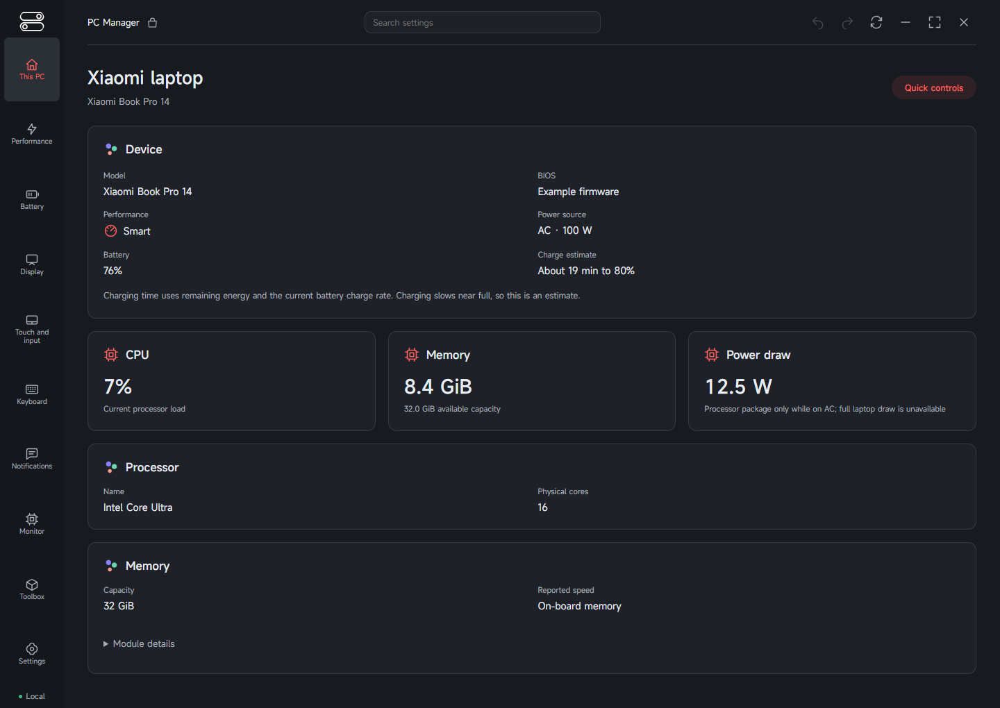
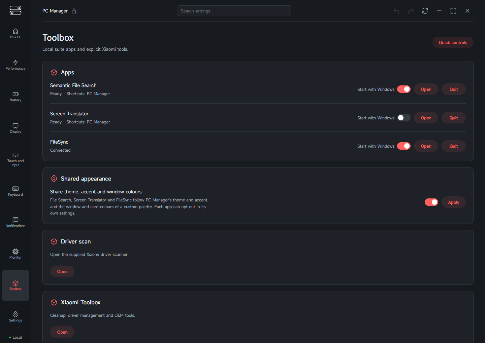

# Xiaomi Revamp

**Your laptop controls, local file search and screen translation, together.**

Xiaomi Revamp is a set of three Windows apps that work well together and can also be used on their own. **PC Manager** puts every laptop control in one place. **AI Center** finds your files by name, by what is written in them, or by what they are about. **Screen Translator** shows Chinese text on your screen in English, right where it was. Search and translation run entirely on your computer.

## The three apps

| App | In one sentence | Guide |
| --- | --- | --- |
| **PC Manager** | Performance, battery care, display, keyboard and touch settings, a quick panel in the tray, and shortcuts for everything. | [PC Manager guide](source/pc-manager/README.md) |
| **AI Center / File Search** | A search bar that finds a document even when you remember its subject better than its name. | [Search guide](source/file-search/README.md) |
| **Screen Translator** | Translate the Chinese on your screen, or on a part of it, with the English laid over the original. | [Translator guide](source/screen-translator/README.md) |

## Everything PC Manager can do

**Performance and power**
- Switch performance modes from the window, the quick panel or the Mi key. On mains power: Silent, Smart, Full speed and Eco. On battery: Eco, Quiet, Auto and Turbo.
- Choose one mode for mains power and another for battery; PC Manager switches when you plug in or unplug.
- **Stay awake** keeps the laptop working; **Prevent sleep** keeps it working while still letting the screen turn off.

**Battery**
- Set a daily charge limit (80, 70, 60, 50 or 40 %) to make the battery last longer.
- **Travel charging** allows one full charge for a trip; the daily limit comes back when you unplug.
- See battery health and, while charging, the charger's power (for example "AC · 100 W") in the quick panel and on the overview.

**Display**
- Brightness, with optional automatic brightness from the light sensor.
- Refresh rate: pick one, cycle with a key, or let PC Manager use one rate on mains power and another on battery. When the PC starts, the right rate is set at the sign-in screen, so the screen does not flicker once you are at work.
- A pop-up confirms a refresh rate change, and only appears when the rate actually changes.
- **Screen off now** turns the screen off without locking or sleeping.

**Keyboard and keys**
- Up to 16 shortcuts of your own: open an app, a file, a PC Manager page or a device action. Record the keys you press or pick from a list.
- The Mi key: a short press changes the performance mode, a long press opens the quick panel. The Copilot key can be given another action.
- Xiaomi-style pop-ups for the special keys: microphone, Caps Lock, Fn lock, keyboard backlight, performance mode and more. Choose Xiaomi's original look or the XiControl style.
- In developer mode, key diagnostics show the last event each special key sent.

**Touch and input**
- Turn the touchpad and the touchscreen on or off.
- Adjust the touchpad's haptic strength and click force.

**Quick panel and tray**
- A compact panel in the tray for the controls you use most, plus links to apps and files.
- Choose which controls appear, their order, the panel's size, position, compact layout and animation.

**Hardware monitor**
- Small, medium or large monitor views of processor, graphics, AI chip, memory, temperature and power, with graphs and an optional log file.
- The overview lists your PC's specifications, memory and storage.

**Look and feel**
- Light or dark theme, color presets, your own accent, background and card colors, and a profile picture.
- Asset packs: import your own button icons, pop-up images and styles.
- The other apps can follow PC Manager's theme and accent.

**Xiaomi's own tools**
- PC Manager keeps Xiaomi's original background tools from overriding your settings, and can still open Xiaomi PC Manager, Xiaomi Store, XiaoAI, the original quick panel and its meeting subtitles (Xiaomi account needed) when they are installed.
- Links to official downloads and support.

**Settings and safety**
- Undo and redo for settings changes, and a settings backup you can restore.
- Starts with Windows and stays in the tray. Some hardware controls need administrator approval.

## Everything AI Center / File Search can do

**Searching**
- Press **Ctrl twice** for a small search bar anywhere. Type a name, a phrase or a description, and press **Enter**.
- Three kinds of matches: by file name, by the words inside the file, and by meaning (a document about "holiday plans" is found with "vacation").
- Narrow to a file type from the list or by adding it to your search, such as `project report pdf`.
- Your programs from the Start menu appear in the results too.
- Click a result to open it; right-click for **Show in Explorer** (also for programs: it opens the folder of the program's file), **Open with**, and **Run** for scripts.
- Scripts (.bat, .cmd, .ps1, .py, .sh) open by default. Choose script types under **Run on click** if you want a click to run them instead.
- Type a folder path such as `~\Documents` or `C:\` to browse it and press **Enter** to open it in Explorer.

**Keywords**
- Give a short word to a program, file or folder, for example `ps` for PowerShell or `vs` for VS Code. Type the word and press **Enter** to open it at once, without a search.
- A keyword can also run a script, or a command of your own in PowerShell 7, Command Prompt or Git Bash: `flush` for `ipconfig /flushdns`. It runs quietly with a notice saying how it went, or in a terminal window that stays open, as you choose.
- Add keywords as rows in Search settings, with a **Browse** button to pick the program or script.
- PowerShell, Windows PowerShell and Command Prompt open in Windows Terminal with their usual title and icon.

**What gets searched**
- Choose the folders to search and the folders to leave out.
- Some file types can be searched by name only (their contents are never read), or by name and words only, without meaning search.
- Choose whether indexing runs all the time, once a day, in a battery-saving way, or is paused.
- Progress shows how much is indexed and how much is understood for meaning search, with an estimated time left.

**Memory and speed**
- **Keep loaded**: searches are instant, the search model stays in memory.
- **Free when idle**: the model leaves memory when you are not searching and loads again while you type.
- Uses the Intel graphics, AI chip (NPU) or processor, whichever you prefer and is available.

**Your index**
- The index stays on your computer, protected by Windows encryption where available.
- **Index and backup** shows where the index is and makes a backup before a reinstall.
- Font, result size, accent and the search bar's look are yours to choose.

## Everything Screen Translator can do

- **Translate screen** or **Select region**, from its window, the quick panel or a shortcut.
- The English appears over the original Chinese, in the same place; switch between original and translated, save a PNG, or press **Esc** to close.
- **Translation filter** keeps translating while the screen changes, for example while you scroll.
- English, numbers and mixed labels are left as they are, so app names and buttons stay recognizable.
- Text size and fitting options; text that cannot fit is marked.
- Power profiles: **Auto** follows Windows' power mode, **Eco** refreshes less often.
- Shows when its models are loaded, with **Stop inference** and **Exit app and unload models** to free memory.
- Works offline: images and recognized text stay in memory unless you save a screenshot. The bundled models translate **Chinese to English**.

## Working together

- One place for shortcuts: **PC Manager → Keyboard** manages the shortcuts of all three apps. Giving a key that is already taken swaps the two actions. When PC Manager is closed, each app handles its own shortcuts.
- The **Toolbox** in PC Manager opens the other apps, their settings and their start-with-Windows switch.
- Shared theme and accent across the apps, and FileSync too when installed.

## Install and start

1. For all three apps, open the [Xiaomi Revamp 0.3.27 release](https://github.com/Alex-Irae/Xiaomi-PC-Manager-Extended/releases/tag/v0.3.27). Run **Xiaomi-Revamp-Installer.exe** and choose which optional apps to install.
2. For just PC Manager, or to update it after installing the full set, download **PC-Manager-Installer.exe** from the [PC Manager 0.2.22 release](https://github.com/Alex-Irae/Xiaomi-PC-Manager-Extended/releases/tag/pc-manager-v0.2.22). Quit Revamp PC Manager from its tray before updating. Choose your existing Xiaomi Revamp folder and keep the same user scope and startup option. Setup retains your settings and the previous PC Manager folder.
3. Open **PC Manager**, **AI Center**, **File Search** or **Screen Translator** from the Start menu. PC Manager's Toolbox opens them too.

To remove an app, use Windows Settings or the app's **Uninstall.exe**, and read its choices before deleting saved settings or a search index you want to keep.

**What's new in PC Manager 0.2.22.** In **Keyboard**, map **Copilot key** to **Open File Search** and **XiaoAI key (F7)** to **Translate screen** or **No action**. Toolbox and Driver Scan look for Xiaomi's manager across versioned install folders, and the PC Manager window retries when WebView2 disconnects. See the [PC Manager guide](source/pc-manager/README.md).

**Versions.** The full Xiaomi Revamp **0.3.27** installer includes PC Manager **0.2.20**, AI Center **0.3.18**, and Screen Translator **0.2.9**. The smaller **0.2.22** update replaces only PC Manager.

## Before you install

- **Windows 11, 64-bit.** Microsoft Edge WebView2 is needed (it is part of Windows 11).
- **Xiaomi laptop for the hardware controls.** Tested on the Xiaomi Book Pro 14 2026. Other Xiaomi models may offer different controls; on other PCs PC Manager opens, but the Xiaomi-specific controls are not available.
- **Intel processor for search and translation.** They use the Intel graphics, AI chip or processor.
- **Time for the first index.** A large document collection can take hours to index the first time. Loading the models also takes a moment, especially the very first time.

The full list is in [requirements](REQUIREMENTS.txt).

## Your data

Everything stays on your computer. Search reads your files to build a local index; translation looks at your screen only when you ask. Nothing is sent to an online service, except Xiaomi's own meeting subtitles if you choose to open them, and the optional download of missing translation models when you ask for it.

## Linux (in progress)

A first base for Arch Linux with Hyprland is in [`linux/`](linux/README.md): the same pages in native windows, the same search and translation, and a new hardware layer for PC Manager. It has not run on Linux yet; that page says what was checked and what was not.

## More

[Screenshot tour](docs/SCREENSHOTS.md) · [Release notes](RELEASE_NOTES.md) · [Technical and developer reference](DEVELOPMENT.md) (data locations, how the apps connect, building from source)

This is an unofficial project, not a Xiaomi product. PC Manager builds on XiControl 0.16.0; its [GPLv3 license](source/pc-manager/LICENSE), upstream authorship and third-party notices are kept.

Screenshots use demonstration data. Readings, file names and progress are examples, not measurements or anyone's personal files.
