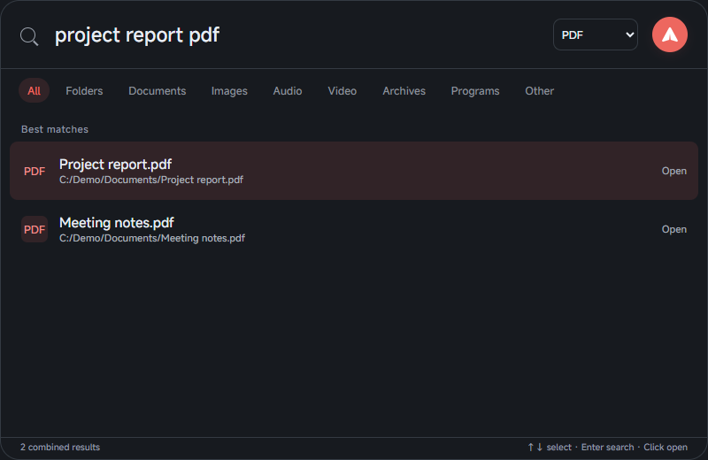
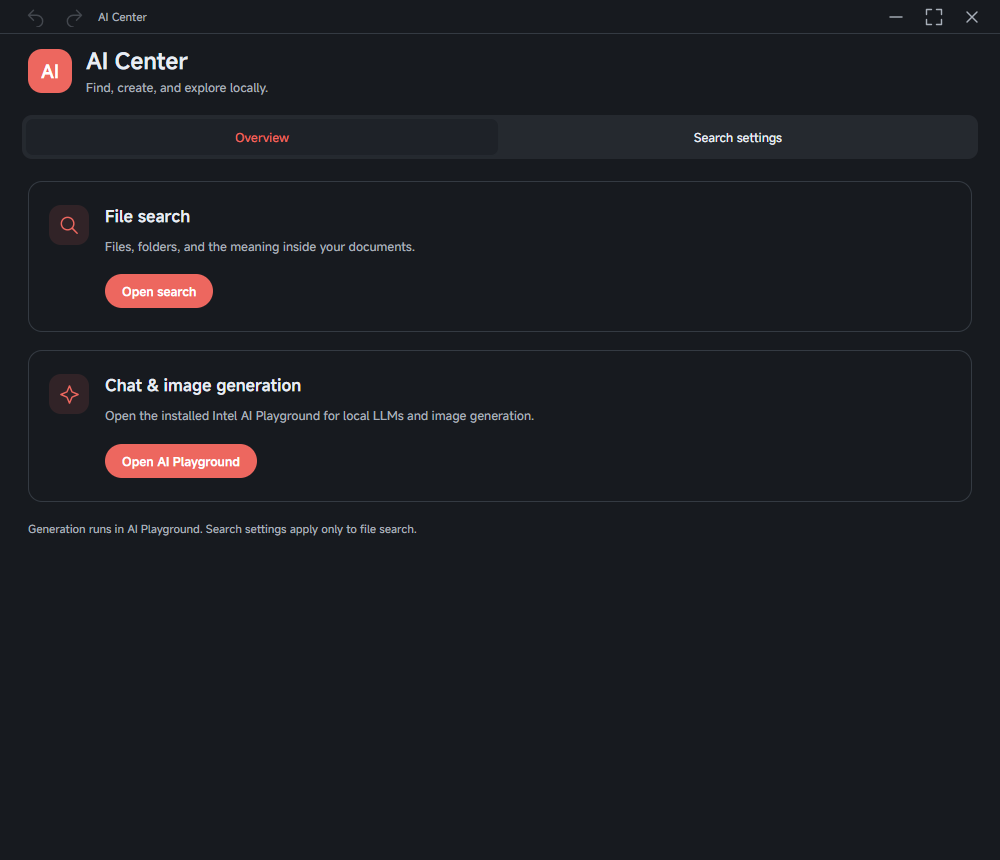
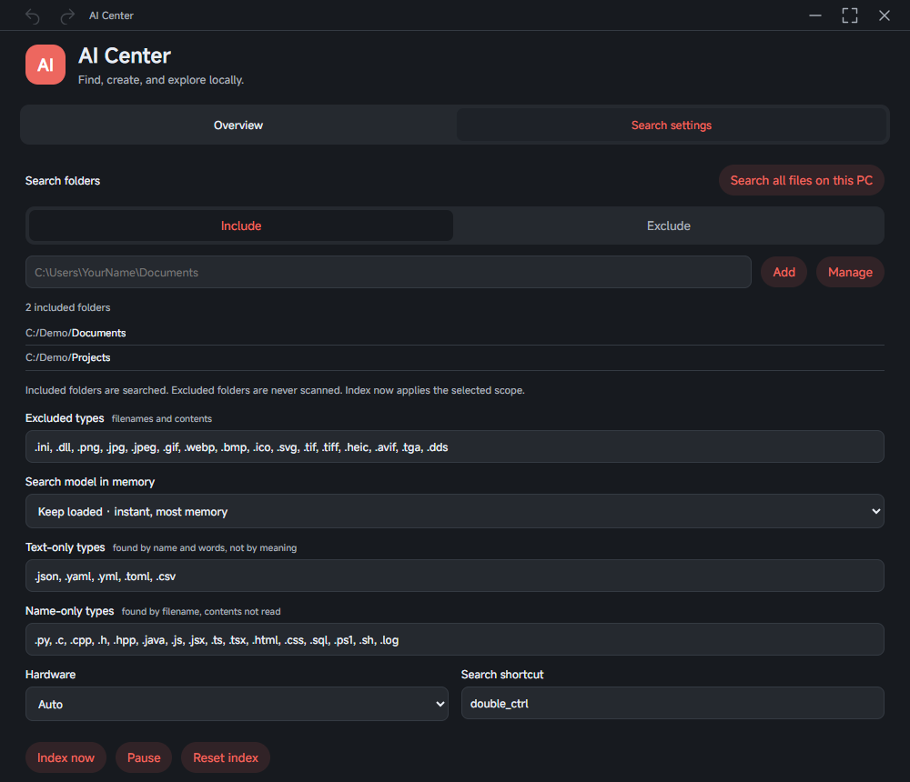
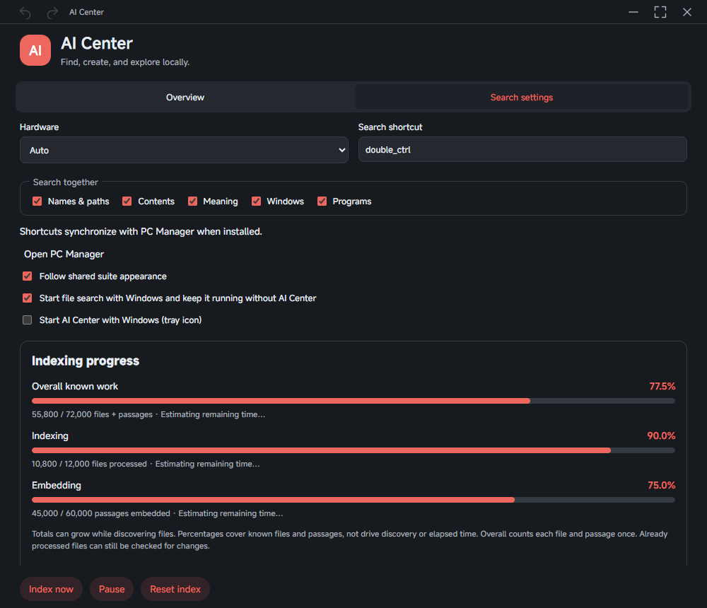
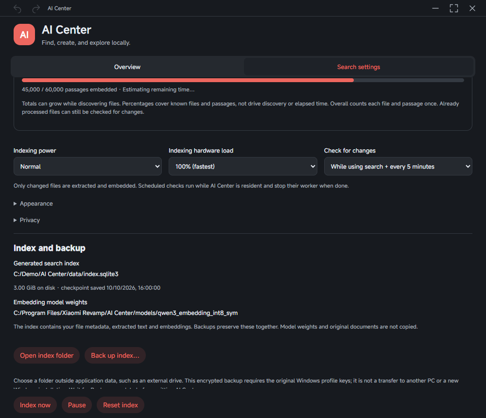

# AI Center and File Search

**Find files by what you remember, not just what they are called.**

File Search combines filename and path matches, document contents and local meaning search. Optional Windows Search and Programs results can join the same list. AI Center is the launcher and settings window; File Search is the small bar you use every day.

Current source: **0.3.18**, part of Xiaomi Revamp **0.3.27**. [Install and check compatibility](../../README.md#install-and-start).

## Your first search

1. Open **AI Center**, then Settings, and choose the folders you want indexed.
2. Let indexing and embedding build the local index. Filename results can become available before meaning search finishes.
3. Press **Ctrl twice**, or open **File Search** from Windows or PC Manager.
4. Type a filename, phrase or description and press **Enter**. Click a result to open it; its context menu also provides **Show in Explorer** and **Open with**, and **Run** for scripts (.bat, .cmd, .ps1, .py, .sh).

Enter always submits a search, including when a result is selected. It does not open a document. Double Ctrl opens the compact bar, not the AI Center window. A direct AI Center launch opens the launcher.

## Narrow it down

Use the file-type selector, or put a file type at either end of your query:

| Query | Searches |
| --- | --- |
| `project report pdf` | PDF files matching “project report” |
| `pdf project report` | The same PDF restriction |
| `pdf` | PDF files without additional query words |
| `"pdf" instructions` | The literal word “pdf”, without automatically selecting PDF |

Choose **All types** to clear the restriction. A type word in the middle of a query remains ordinary text. Settings let you select which search channels are enabled.

## Choose what gets indexed

Add included folders and exclusions in Settings. Excluding a folder excludes **that folder and all its descendants**. Name-only file types remain searchable by name without reading their contents; text-only types can be searched as text without generating embeddings.

**Keywords** do something without searching. In Search settings, each keyword is a row: the word, then what it does:

- **Open** a program, file or folder (for example `ps` for `powershell.exe`); **Browse** picks it.
- **Run** a script file (.bat, .cmd, .ps1, .py, .sh) instead of opening it.
- **Command**: run a command line in PowerShell 7, Command Prompt or Git Bash, for example `flush` for `ipconfig /flushdns`.

Run and Command rows choose a window: **Hidden, notice** runs without a window and a Windows notice says whether it worked, with the last line it printed; **Terminal window** shows the output in a window titled with the keyword, which stays open. Commands start in your user folder, scripts in their own folder, with AI Center's rights. Type the word in the search bar and press **Enter**.

**Scripts in the results** open by default, like any file. Right-click one for **Run**, or list its type under **Run on click** in Search settings (for example `.bat`) to make a click run it. Results always run in a terminal window.

The model's memory options balance readiness against RAM use. **Keep loaded** keeps it available for repeated searches. Idle options release memory when appropriate; active indexing still needs the embedding model. A cold start can take time.

## See progress and protect your index

The indexing section shows separate **overall**, **indexing** and **embedding** percentages, plus an estimated time remaining when enough recent progress is available.

These percentages describe work discovered so far. They can move backwards when more folders or passages are found. A large first index can take hours or days; an ETA is an estimate, not a finish-time guarantee.

Use **Index and backup** in Settings to inspect the index location and make a backup before a reinstall or major change. Keep it somewhere separate from the active index. Protected backups depend on the Windows account and its encryption material; they are not a general cross-device migration format. Backing up the index does not back up your documents.

## Installation and where data lives

Select AI Center in the [combined installer](../../README.md#install-and-start), or use a standalone installer when available. Launch `AI Center\AI Center.exe` for the main window; the **File Search** Windows shortcut opens the compact bar. PC Manager's Toolbox provides the same separate actions.

The installer can choose a separate AI Center data folder. Configuration and the `data/` directory contain the index, history and browser state; the model is in the app's model folder or the configured model path. Current indexing uses a disk-backed database, with Windows EFS protection by default where available. Windows Home does not support EFS. See [requirements](../../REQUIREMENTS.txt) for supported hardware and protection limits.

Meaning search runs locally using OpenVINO on compatible Intel hardware, preferring the available GPU, then NPU, then CPU. Windows Search is needed only for its optional channel. AI Playground and XiaoAI cards launch separately installed software. This project does not bundle those applications.

## For developers

`frontend/` contains the launcher, compact bar and settings; `native/` hosts the Windows app; `xiaomi_search/` performs indexing and retrieval. Changes are developed in a separate source checkout, not by modifying the installed EXE. [Developer reference](DEVELOPMENT.md) retains configuration, architecture and earlier validation details; [workspace development](../../DEVELOPMENT.md) explains the current workflow.

Screenshots show the current interface with demonstration data. Hardware readings, file names, progress and device states are examples, not performance measurements or your personal files.
